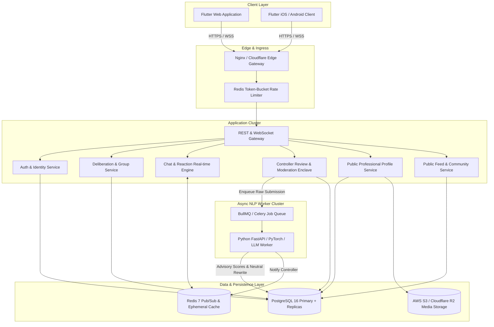
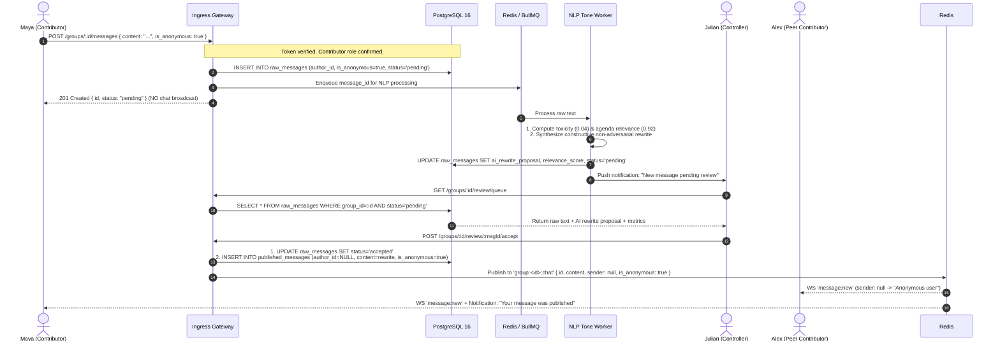

# Architecture & System Design Document
## Talk It Out — Scalable Safe Deliberation & Psychological Safety Platform

**Document Version:** 1.0 (Production Engineering Specification)  
**Target Audience:** Backend Engineers, Database Architects, DevOps, NLP Engineers  
**Frontend Framework:** Flutter 3.x (Web & Mobile, Riverpod 2.x, GoRouter)  
**Backend Target Stack:** Node.js / TypeScript (NestJS / Express) or Go, PostgreSQL 16, Redis 7, Python (FastAPI / Celery) for NLP Worker  

---

## 1. System Overview & Component Topology

Talk It Out decouples identity from speech while enforcing conversational tone hygiene. The platform consists of six discrete architectural tiers designed for high concurrency, zero-leak privacy, and sub-second real-time synchronization.



---

## 2. Mathematical & Cryptographic Anonymity Enclave

### 2.1 The Zero-Knowledge Identity Decoupling Principle
Conventional collaboration platforms (Slack, Teams, Discord) store the user's `user_id` on every message row and simply hide the author name on the client with CSS or UI logic. **This is fundamentally prohibited in Talk It Out.** If an attacker inspects network traffic or a compromised client views incoming WebSocket payloads, a traditional system leaks the real author.

In Talk It Out, anonymity is enforced at the persistence and serialization layers:

1. **Dual-Table Isolation:**
   - `raw_messages`: Stores the author's true `author_id`, the original submitted text, and the AI evaluation scores. This table is restricted to Controller-guarded endpoints (`/groups/:id/review/queue`).
   - `published_messages`: Stores the accepted text published to the group. If the message was marked anonymous (`is_anonymous = true`), `author_id` is set to `NULL` at the database level.
2. **Cryptographic Erasure on Publication:**
   - Once a message is accepted and published, peer contributors querying `/groups/:id/messages` or listening to the WebSocket topic `group:<groupId>` receive a payload where `sender` is completely `null`.
   - The server never exposes `raw_message_id` to contributor clients.
3. **Author Ledger ("My Messages"):**
   - Individual contributors need to know if their own submission was accepted or rejected.
   - When a contributor queries `/groups/:id/my-messages`, the database returns only their own rows from `raw_messages` filtered by `author_id = req.user.id`.
   - **Crucial Rule:** The API returns *only* metadata: `{ id, status, is_anonymous, created_at, published_message_id }`. The API *never* echoes back the raw text, never reveals the rejection reason (to avoid adversarial probe attacks), and never returns other users' submissions.



---

## 3. Complete PostgreSQL Database Schema (Production DDL)

The following schema is fully normalized, indexed for high-throughput queries, and enforces strict relational integrity with foreign keys, checks, and enums.

```sql
-- ============================================================================
-- EXTENSIONS & ENUMS
-- ============================================================================
CREATE EXTENSION IF NOT EXISTS "uuid-ossp";
CREATE EXTENSION IF NOT EXISTS "citext";

CREATE TYPE user_role_enum AS ENUM ('member', 'admin', 'moderator');
CREATE TYPE group_member_role_enum AS ENUM ('controller', 'contributor');
CREATE TYPE message_status_enum AS ENUM ('pending', 'accepted', 'rejected');
CREATE TYPE notification_type_enum AS ENUM ('review_pending', 'message_accepted', 'message_rejected', 'group_invite', 'mention');

-- ============================================================================
-- 1. USERS & PROFILES
-- ============================================================================
CREATE TABLE users (
    id UUID PRIMARY KEY DEFAULT uuid_generate_v4(),
    email CITEXT UNIQUE NOT NULL,
    username VARCHAR(50) UNIQUE NOT NULL,
    password_hash VARCHAR(255) NOT NULL,
    full_name VARCHAR(100) NOT NULL,
    avatar_url TEXT,
    headline VARCHAR(255) DEFAULT 'Individual Contributor',
    role user_role_enum DEFAULT 'member',
    is_active BOOLEAN DEFAULT TRUE,
    created_at TIMESTAMPTZ DEFAULT NOW(),
    updated_at TIMESTAMPTZ DEFAULT NOW()
);

CREATE TABLE user_profiles (
    user_id UUID PRIMARY KEY REFERENCES users(id) ON DELETE CASCADE,
    bio TEXT,
    cover_url TEXT,
    location VARCHAR(120),
    website VARCHAR(255),
    github_handle VARCHAR(100),
    twitter_handle VARCHAR(100),
    linkedin_url VARCHAR(255),
    skills TEXT[] DEFAULT '{}',
    updated_at TIMESTAMPTZ DEFAULT NOW()
);

CREATE TABLE user_experiences (
    id UUID PRIMARY KEY DEFAULT uuid_generate_v4(),
    user_id UUID NOT NULL REFERENCES users(id) ON DELETE CASCADE,
    title VARCHAR(120) NOT NULL,
    company VARCHAR(120) NOT NULL,
    location VARCHAR(120),
    start_date DATE NOT NULL,
    end_date DATE,
    is_current BOOLEAN DEFAULT FALSE,
    description TEXT,
    display_order INT DEFAULT 0,
    created_at TIMESTAMPTZ DEFAULT NOW()
);

CREATE TABLE user_educations (
    id UUID PRIMARY KEY DEFAULT uuid_generate_v4(),
    user_id UUID NOT NULL REFERENCES users(id) ON DELETE CASCADE,
    school VARCHAR(150) NOT NULL,
    degree VARCHAR(100) NOT NULL,
    field_of_study VARCHAR(100),
    start_year INT,
    end_year INT,
    created_at TIMESTAMPTZ DEFAULT NOW()
);

-- ============================================================================
-- 2. GROUPS & MEMBERSHIP
-- ============================================================================
CREATE TABLE groups (
    id UUID PRIMARY KEY DEFAULT uuid_generate_v4(),
    title VARCHAR(150) NOT NULL,
    agenda TEXT NOT NULL,
    controller_id UUID NOT NULL REFERENCES users(id) ON DELETE RESTRICT,
    banner_gradient VARCHAR(100) DEFAULT 'from-blue-600 to-indigo-900',
    is_active BOOLEAN DEFAULT TRUE,
    created_at TIMESTAMPTZ DEFAULT NOW(),
    updated_at TIMESTAMPTZ DEFAULT NOW()
);

CREATE TABLE group_members (
    id UUID PRIMARY KEY DEFAULT uuid_generate_v4(),
    group_id UUID NOT NULL REFERENCES groups(id) ON DELETE CASCADE,
    user_id UUID NOT NULL REFERENCES users(id) ON DELETE CASCADE,
    role group_member_role_enum NOT NULL DEFAULT 'contributor',
    joined_at TIMESTAMPTZ DEFAULT NOW(),
    CONSTRAINT uq_group_member UNIQUE (group_id, user_id)
);

-- ============================================================================
-- 3. DUAL-TABLE DELIBERATION MESSAGING
-- ============================================================================

-- Table A: Raw submissions (accessible strictly by Controller & Author's own status query)
CREATE TABLE raw_messages (
    id UUID PRIMARY KEY DEFAULT uuid_generate_v4(),
    group_id UUID NOT NULL REFERENCES groups(id) ON DELETE CASCADE,
    author_id UUID NOT NULL REFERENCES users(id) ON DELETE CASCADE,
    raw_content TEXT NOT NULL,
    is_anonymous BOOLEAN DEFAULT FALSE,
    status message_status_enum NOT NULL DEFAULT 'pending',
    relevance_score NUMERIC(4, 3) CHECK (relevance_score >= 0.0 AND relevance_score <= 1.0),
    toxicity_score NUMERIC(4, 3) CHECK (toxicity_score >= 0.0 AND toxicity_score <= 1.0),
    ai_rewrite_proposal TEXT,
    ai_rationale TEXT,
    submitted_at TIMESTAMPTZ DEFAULT NOW(),
    reviewed_at TIMESTAMPTZ,
    reviewed_by UUID REFERENCES users(id) ON DELETE SET NULL
);

-- Table B: Published Messages (public to all group members)
-- CRITICAL SECURITY CONSTRAINT: If is_anonymous = true, author_id MUST BE NULL
CREATE TABLE published_messages (
    id UUID PRIMARY KEY DEFAULT uuid_generate_v4(),
    group_id UUID NOT NULL REFERENCES groups(id) ON DELETE CASCADE,
    raw_message_id UUID REFERENCES raw_messages(id) ON DELETE SET NULL,
    author_id UUID REFERENCES users(id) ON DELETE SET NULL,
    content TEXT NOT NULL,
    is_anonymous BOOLEAN DEFAULT FALSE,
    is_controller BOOLEAN DEFAULT FALSE,
    parent_id UUID REFERENCES published_messages(id) ON DELETE SET NULL,
    published_at TIMESTAMPTZ DEFAULT NOW(),
    CONSTRAINT chk_anonymity_author_null CHECK (
        (is_anonymous = TRUE AND author_id IS NULL) OR
        (is_anonymous = FALSE)
    )
);

-- Message Reactions (Emoji Reactions: 👍, ❤️, 🔥, 💡, 👏, 🎯)
CREATE TABLE message_reactions (
    id UUID PRIMARY KEY DEFAULT uuid_generate_v4(),
    message_id UUID NOT NULL REFERENCES published_messages(id) ON DELETE CASCADE,
    user_id UUID NOT NULL REFERENCES users(id) ON DELETE CASCADE,
    emoji VARCHAR(10) NOT NULL,
    created_at TIMESTAMPTZ DEFAULT NOW(),
    CONSTRAINT uq_user_message_emoji UNIQUE (message_id, user_id, emoji)
);

-- ============================================================================
-- 4. PUBLIC FEED & DISCUSSIONS
-- ============================================================================
CREATE TABLE feed_posts (
    id UUID PRIMARY KEY DEFAULT uuid_generate_v4(),
    author_id UUID NOT NULL REFERENCES users(id) ON DELETE CASCADE,
    content TEXT NOT NULL,
    likes_count INT DEFAULT 0,
    comments_count INT DEFAULT 0,
    created_group_id UUID REFERENCES groups(id) ON DELETE SET NULL,
    created_at TIMESTAMPTZ DEFAULT NOW(),
    updated_at TIMESTAMPTZ DEFAULT NOW()
);

CREATE TABLE feed_comments (
    id UUID PRIMARY KEY DEFAULT uuid_generate_v4(),
    post_id UUID NOT NULL REFERENCES feed_posts(id) ON DELETE CASCADE,
    author_id UUID NOT NULL REFERENCES users(id) ON DELETE CASCADE,
    content TEXT NOT NULL,
    created_at TIMESTAMPTZ DEFAULT NOW()
);

CREATE TABLE feed_likes (
    post_id UUID NOT NULL REFERENCES feed_posts(id) ON DELETE CASCADE,
    user_id UUID NOT NULL REFERENCES users(id) ON DELETE CASCADE,
    created_at TIMESTAMPTZ DEFAULT NOW(),
    PRIMARY KEY (post_id, user_id)
);

-- ============================================================================
-- 5. NOTIFICATIONS
-- ============================================================================
CREATE TABLE notifications (
    id UUID PRIMARY KEY DEFAULT uuid_generate_v4(),
    recipient_id UUID NOT NULL REFERENCES users(id) ON DELETE CASCADE,
    type notification_type_enum NOT NULL,
    title VARCHAR(150) NOT NULL,
    body TEXT NOT NULL,
    group_id UUID REFERENCES groups(id) ON DELETE CASCADE,
    published_message_id UUID REFERENCES published_messages(id) ON DELETE CASCADE,
    is_read BOOLEAN DEFAULT FALSE,
    created_at TIMESTAMPTZ DEFAULT NOW()
);

-- ============================================================================
-- INDEXES FOR HIGH-THROUGHPUT PERFORMANCE
-- ============================================================================
CREATE INDEX idx_group_members_user ON group_members(user_id);
CREATE INDEX idx_group_members_group_role ON group_members(group_id, role);
CREATE INDEX idx_raw_messages_review ON raw_messages(group_id, status) WHERE status = 'pending';
CREATE INDEX idx_raw_messages_author_lookup ON raw_messages(author_id, group_id);
CREATE INDEX idx_published_messages_group_time ON published_messages(group_id, published_at ASC);
CREATE INDEX idx_message_reactions_message ON message_reactions(message_id);
CREATE INDEX idx_notifications_recipient_unread ON notifications(recipient_id, is_read) WHERE is_read = FALSE;
CREATE INDEX idx_feed_posts_created ON feed_posts(created_at DESC);
CREATE INDEX idx_feed_comments_post ON feed_comments(post_id, created_at ASC);
```

---

## 4. NLP & AI Moderation Worker Pipeline

### 4.1 Worker Architecture
The AI processing layer is decoupled from the HTTP API via Redis / BullMQ. The HTTP API returns `201 Created` immediately upon persisting the contributor's raw draft, ensuring the mobile/web UI never hangs on LLM latency.

```
[Raw Message Posted]
       │
       ▼
BullMQ Job ('nlp_queue', { raw_message_id })
       │
       ▼
[Stage 1: Heuristic & Vector Analysis]
   ├─► Toxicity Classifier (< 0.15 = Clean, 0.15-0.5 = Warning, > 0.5 = High)
   └─► Cosine Similarity (raw_text_embeddings · group_agenda_embeddings)
       │
       ▼
[Stage 2: Non-Adversarial Tone Synthesis]
   └─► LLM Prompt with Strict Substance Invariance
       │
       ▼
[Update DB & Trigger WebSocket Event]
   ├─► UPDATE raw_messages SET ai_rewrite_proposal, relevance_score, toxicity_score
   └─► Publish WS 'group:<id>:review' event to Room Controller
```

### 4.2 Tone Synthesis Prompt Template
```jinja2
SYSTEM PROMPT:
You are the AI Deliberation Engine for Talk It Out.
Your task is to rephrase raw team feedback into a constructive, objective, and non-adversarial proposal suitable for executive and peer review.

STRICT CONSTRAINTS:
1. PRESERVE 100% OF SUBSTANTIVE CONTENT: Every bug, architectural risk, deadline concern, resource deficiency, or dissenting technical opinion MUST be retained.
2. ELIMINATE ADVERSARIAL ELEMENTS: Remove sarcasm, blame ("you never", "management failed"), emotional hostility, passive-aggressive phrasing, and personal attacks.
3. ADOPT COLLABORATIVE ACTIONABLE FRAMING: Use solution-oriented language ("We should consider...", "To mitigate risk X, could we explore Y...").
4. RETURN VALID JSON STRICTLY adhering to the schema below.

INPUT CONTEXT:
Group Title: {{ group.title }}
Group Agenda: {{ group.agenda }}
Raw Contributor Submission: "{{ raw_message.content }}"

OUTPUT JSON SCHEMA:
{
  "rewrite": "Constructive version of the message",
  "relevance_score": 0.0 to 1.0 (float: semantic alignment with agenda),
  "toxicity_score": 0.0 to 1.0 (float: hostility/aggression level of raw text),
  "rationale": "One-sentence explanation of what tone adjustments were made",
  "key_points_preserved": ["Point 1", "Point 2"]
}
```

---

## 5. WebSocket Real-Time Event Protocol

All real-time communication occurs over WebSocket connections authenticated via JWT query parameter or initial handshake header (`Authorization: Bearer <token>`).

### 5.1 Socket Room Partitioning
- `room:group:<groupId>`: Public chat room joined by all members of the group.
- `room:group:<groupId>:controller`: Protected room joined **only** by the verified Controller of that group.
- `room:user:<userId>`: Private channel for user-specific push notifications (e.g. message accepted/rejected).

### 5.2 Real-time Event Specification

#### Contributor Posts Message (Queue Update)
- **Event:** `review:new_submission`
- **Destination:** `room:group:<groupId>:controller`
- **Payload:**
```json
{
  "event": "review:new_submission",
  "groupId": "7b8e1f20-...",
  "rawMessageId": "3c9d2a10-...",
  "status": "pending",
  "pendingCount": 3
}
```

#### Controller Publishes Rewrite
- **Event:** `chat:message_published`
- **Destination:** `room:group:<groupId>`
- **Payload (Anonymous Message Example):**
```json
{
  "event": "chat:message_published",
  "groupId": "7b8e1f20-...",
  "message": {
    "id": "a1b2c3d4-...",
    "content": "To prevent regressions in sprint deliverables, let's explore implementing an automated linting check on pull requests.",
    "isAnonymous": true,
    "isController": false,
    "sender": null,
    "replyTo": null,
    "reactions": {},
    "publishedAt": "2026-10-20T01:15:00.000Z"
  }
}
```
*(Notice: `sender` is strictly `null` and there is no trace of `author_id` or `raw_message_id`).*

#### Real-time Reaction Added
- **Event:** `chat:reaction_updated`
- **Destination:** `room:group:<groupId>`
- **Payload:**
```json
{
  "event": "chat:reaction_updated",
  "messageId": "a1b2c3d4-...",
  "reactions": {
    "👍": 4,
    "💡": 2
  },
  "userReactions": ["👍"]
}
```

---

## 6. Security, Threat Modeling & Hard Compliance

| Attack / Threat Vector | Vulnerability in Standard Apps | Talk It Out Mitigation |
|---|---|---|
| **Database Compromise (SQL Leak)** | Column `author_id` in chat tables reveals anonymous leakers. | `published_messages.author_id` is set to `NULL` via DB constraint. Decoupled UUID keys prevent foreign key traversal. |
| **Network Sniffing / MITM** | Client receives full author object with `hidden: true` flag. | Serialization interceptors drop author data prior to JSON emission; group broadcast has `sender = null`. |
| **Timing Correlation Attack** | Contributor posts at 10:04:12; message appears in chat at 10:04:13. | The Controller Review Queue introduces an asynchronous human-in-the-loop buffer, breaking temporal correlation. |
| **Adversarial Probe on Rejection** | Contributor gets detailed rejection reasoning to reverse-engineer filter rules or Controller identity. | Hard rejection policy: The API returns status `rejected` with zero reason string, preventing feedback probing. |
| **Unauthorized Review Access** | Malicious contributor calls `/groups/:id/review/queue`. | Route guard checks `group_members.role = 'controller'`. Non-controllers receive an immediate `403 Forbidden`. |
| **Token Theft / Replay** | Tokens stored in unencrypted LocalStorage. | Flutter frontend uses `flutter_secure_storage` (iOS Keychain / Android KeyStore). Short-lived JWTs (15 min) + Refresh Token rotation. |

---

## 7. Storage & Media Upload Flow

To support custom avatars and cover photos without accepting arbitrary unvalidated external URLs:
1. **Client Upload:** Flutter client uses `pickImageFile()` which reads the local image and transmits it as multipart form data to `POST /api/v1/users/me/avatar` or `POST /api/v1/users/me/cover`.
2. **Virus & MIME Inspection:** The backend validates file magic numbers (`image/png`, `image/jpeg`, `image/webp`), limits payload size to 5MB, and strips EXIF metadata.
3. **Storage:** Image is uploaded to S3 / Cloudflare R2 bucket with random UUID filenames.
4. **CDN URL Return:** The backend stores the secure HTTPS CDN URL in `users.avatar_url` or `user_profiles.cover_url` and returns `{ url: "https://cdn.talkitout.app/avatars/uuid.webp" }`.

---

**Approved by:** Architecture Team & Core Security Enclave  
**Next Steps:** Review [PRD.md](file:///Users/oscar/Desktop/talk_it_out/PRD.md) and [PLAN.md](file:///Users/oscar/Desktop/talk_it_out/PLAN.md) for backend sprint execution.
