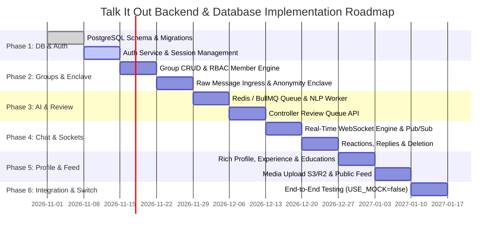

# Engineering Execution Plan (PLAN.md)
## Talk It Out — Backend, Database & NLP Implementation Roadmap

**Document Version:** 1.0  
**Status:** Ready for Sprint Planning & Execution  
**Target Duration:** 4 Sprints (8 Weeks)  
**Assigned Teams:** Backend Engineering, Database Architecture, NLP/ML Team, QA / SecOps  

---

## 1. Executive Roadmap Overview

This execution plan guides the development of the backend services, database migrations, asynchronous NLP pipelines, and real-time infrastructure required to back the completed Flutter frontend.



---

## 2. Phase-by-Phase Technical Tasks & Deliverables

### Phase 1: Database Foundation, Migrations & Authentication Service (Sprint 1, Days 1–14)
**Objective:** Stand up the PostgreSQL 16 cluster, apply schema migrations, and implement JWT-based user authentication compatible with `flutter_secure_storage`.

- [ ] **Task 1.1: Database Infrastructure & Migration Setup**
  - Initialize PostgreSQL 16 with `uuid-ossp` and `citext` extensions.
  - Implement migration files using Prisma, TypeORM, or Flyway based on the DDL defined in `ARCHITECTURE.md`.
  - Create test database seed scripts with initial mock personas:
    - `priya@example.com` / `secret123` (Contributor in Group 1, Controller in Group 2)
    - `julian@example.com` / `secret123` (Controller in Group 1)
    - `maya@example.com` / `secret123` (Contributor)
- [ ] **Task 1.2: User Authentication & Token Lifecycle**
  - Implement `POST /api/v1/auth/register` (email, username, password, full_name).
  - Implement `POST /api/v1/auth/login` returning `{ access_token, refresh_token, user }`.
  - Passwords hashed with Argon2id (`timeCost: 3, memoryCost: 65536, parallelism: 4`).
  - Implement `POST /api/v1/auth/refresh` for rotating refresh tokens stored in Redis.
  - Implement `POST /api/v1/auth/logout` invalidating tokens in Redis blacklist.
- [ ] **Task 1.3: Quality & Security Validation**
  - Run OWASP benchmark checks on auth endpoints.
  - Verify that password hashes and refresh tokens never leak in JSON error responses.

---

### Phase 2: Group Deliberation Engine & Anonymity Ingress (Sprint 2, Days 15–28)
**Objective:** Implement group creation, role-based member management (invite, kick, leave), and the zero-knowledge dual-table message ingress.

- [ ] **Task 2.1: Group Management & Membership RBAC**
  - Implement `GET /api/v1/groups` (list groups where user is member or public rooms).
  - Implement `POST /api/v1/groups` (create new group with `agenda`, `title`, and assign creator as `controller`).
  - Implement `GET /api/v1/groups/:id` returning group details, controller info, and member count.
  - Implement member moderation endpoints:
    - `POST /api/v1/groups/:id/members/invite` (controller can invite user by `@username`).
    - `DELETE /api/v1/groups/:id/members/:userId` (controller kicks member).
    - `POST /api/v1/groups/:id/leave` (contributor voluntarily leaves group).
- [ ] **Task 2.2: Dual-Table Message Ingress & Cryptographic Isolation**
  - Implement `POST /api/v1/groups/:id/messages` (contributor submission).
  - Validate contributor membership; reject if user is not in group.
  - Write record into `raw_messages` with `status: 'pending'`, `is_anonymous: boolean`.
  - Enqueue job `nlp_moderation_queue` with payload `{ raw_message_id }`.
  - Respond immediately with `201 Created` containing `{ id, status: "pending", submitted_at }`. **Do NOT broadcast to group chat.**
- [ ] **Task 2.3: "My Messages" Status Ledger**
  - Implement `GET /api/v1/groups/:id/my-messages`.
  - Query `raw_messages` where `group_id = :id AND author_id = req.user.id`.
  - Return JSON array: `[{ id, status, is_anonymous, submitted_at }]`.
  - **Compliance Check:** Verify raw text is NOT returned and rejection reasons are strictly omitted.

---

### Phase 3: NLP Pipeline, BullMQ Queue & Controller Review Queue (Sprint 2–3, Days 29–42)
**Objective:** Deploy asynchronous AI workers that evaluate raw messages for toxicity and relevance, generate non-adversarial constructive rewrites, and serve the Controller review queue.

- [ ] **Task 3.1: BullMQ & Redis Worker Infrastructure**
  - Configure Redis queue `nlp_moderation_queue` with concurrency limit = 10.
  - Implement worker with retry backoff and dead-letter queue.
- [ ] **Task 3.2: Two-Stage NLP Moderation Pipeline**
  - **Stage 1 (Advisory Scoring):**
    - Run toxicity classification (HuggingFace transformer or Perspective API) -> `toxicity_score` (0.0 to 1.0).
    - Compute cosine similarity between message embedding and group agenda embedding -> `relevance_score` (0.0 to 1.0).
  - **Stage 2 (Non-Adversarial Tone Synthesis):**
    - Call LLM with the prompt defined in `ARCHITECTURE.md` (Section 4.2).
    - Extract JSON schema: `{ rewrite, relevance_score, toxicity_score, rationale }`.
    - Persist results into `raw_messages.ai_rewrite_proposal` and `raw_messages.ai_rationale`.
    - Push WebSocket notification to `room:group:<groupId>:controller` signaling pending item ready.
- [ ] **Task 3.3: Controller Review Queue API**
  - Implement `GET /api/v1/groups/:id/review/queue`.
  - Enforce Controller role guard: return `403 Forbidden` if caller is not the controller.
  - Return array of `RawMessage` objects: `{ id, groupId, author, originalContent, aiRewriteProposal, relevanceScore, toxicityScore, submittedAt }`.

---

### Phase 4: Review Decisions, Parity Messaging & Real-Time WebSockets (Sprint 3, Days 43–56)
**Objective:** Allow controllers to accept rewrites or reject drafts, provide unified controller chat messaging, and synchronize live updates over WebSockets.

- [ ] **Task 4.1: Controller Decision Workflows**
  - Implement `POST /api/v1/groups/:id/review/:messageId/accept`:
    - In a PostgreSQL transaction:
      1. Set `raw_messages.status = 'accepted'`.
      2. Insert into `published_messages`:
         - `content = raw_messages.ai_rewrite_proposal`
         - `is_anonymous = raw_messages.is_anonymous`
         - `author_id = is_anonymous ? NULL : raw_messages.author_id` (Zero-Knowledge rule).
         - `is_controller = FALSE`
      3. Insert into `notifications`: notify author that submission was published.
      4. Publish to Redis channel `group:<id>:chat` with event `message:new`.
  - Implement `POST /api/v1/groups/:id/review/:messageId/reject`:
    - Set `raw_messages.status = 'rejected'`.
    - Insert neutral notification for author: "Your message in <group> was not accepted." (No reason text).
    - Emit event to author's private channel.
- [ ] **Task 4.2: Controller Direct Messaging Parity**
  - Implement `POST /api/v1/groups/:id/messages/controller`:
    - Enforce Controller guard.
    - Insert directly into `published_messages` (`author_id = req.user.id`, `is_controller = TRUE`, `is_anonymous = FALSE`).
    - Publish to group chat immediately without review queue or NLP rewrite.
- [ ] **Task 4.3: Real-Time Chat Engine, Reactions & Replies**
  - Implement WebSocket server (Socket.io or raw `ws`).
  - Implement `POST /api/v1/groups/:id/messages/:messageId/reactions` (toggle emoji 👍, ❤️, 🔥, 💡, 👏, 🎯).
  - Implement reply threading (`parent_id` foreign key referencing parent `published_messages.id`).
  - Implement `DELETE /api/v1/groups/:id/messages/:messageId` (controller can delete inappropriate published messages).

---

### Phase 5: Rich Professional Profiles, Media Uploads & Public Feed (Sprint 4, Days 57–70)
**Objective:** Support full professional profile editing (experiences, educations, skills), image file uploads via S3/R2, and the non-anonymous public feed.

- [ ] **Task 5.1: Profile & Career History Endpoints**
  - Implement `GET /api/v1/users/:id/profile` returning profile, experiences, educations, and skills.
  - Implement `PUT /api/v1/users/me/profile` (update bio, headline, skills, location, linkedin_url, website).
  - Implement `POST / PUT / DELETE /api/v1/users/me/experiences` for work history.
  - Implement `POST / PUT / DELETE /api/v1/users/me/educations` for academic history.
- [ ] **Task 5.2: Image Upload Engine (S3 / Cloudflare R2)**
  - Implement `POST /api/v1/users/me/avatar` accepting multipart image upload.
  - Implement `POST /api/v1/users/me/cover` accepting multipart image upload.
  - Process via Sharp / Pillow (resize to max 1200px width, convert to WebP, compress to < 300KB).
  - Store in S3 bucket, return secure CDN URL.
- [ ] **Task 5.3: Public Feed & Deliberation Conversion**
  - Implement `GET /api/v1/feed` with cursor-based pagination.
  - Implement `POST /api/v1/feed` (author is always visible; zero anonymity in feed).
  - Implement `POST /api/v1/feed/:id/comments` and `POST /api/v1/feed/:id/like`.
  - Implement `POST /api/v1/feed/:id/convert-to-group` (author only, turns viral post into a structured deliberation group).

---

### Phase 6: End-to-End Integration, Security Audits & Production Cutover (Sprint 4, Days 71–84)
**Objective:** Point the Flutter frontend at the live backend by toggling `--dart-define=USE_MOCK=false`, running full integration test suites, and load testing.

- [ ] **Task 6.1: Integration Testing with Flutter Frontend**
  - Launch Flutter with:
    ```bash
    flutter run -d web-server --web-port=52000 --dart-define=USE_MOCK=false --dart-define=API_BASE_URL=http://localhost:3000/api/v1
    ```
  - Verify every user flow: Login -> Group List -> Post Anonymous Message -> Review Queue -> Accept Rewrite -> Live Chat Update -> Add Reaction -> Profile Edit.
- [ ] **Task 6.2: Privacy & Zero-Knowledge Verification Suite**
  - Run automated database assertions:
    - Assert `SELECT COUNT(*) FROM published_messages WHERE is_anonymous = true AND author_id IS NOT NULL;` equals 0.
    - Assert non-controller JWT receiving `403` on review queue.
    - Assert raw message text is never present in network response of `/groups/:id/messages`.
- [ ] **Task 6.3: Load & Concurrency Testing**
  - Simulate 500 concurrent WebSocket connections sending messages and reactions using k6.
  - Ensure p95 message delivery latency is < 200ms.

---

## 3. Team Responsibilities & Ownership Matrix

| Area | Lead Engineer | Secondary | Key Artifacts |
|---|---|---|---|
| **Database & Migrations** | DB Architect | Backend Lead | `migrations/*.sql`, seeds, DDL checks |
| **Auth & Security Enclave** | Security Engineer | Backend Lead | JWT service, Argon2, anonymity validation |
| **NLP Worker & AI Prompts** | NLP/ML Engineer | Backend Engineer | BullMQ worker, LLM prompt, evaluation benchmark |
| **Real-time WebSockets** | Backend Engineer | Frontend Lead | WS gateway, Redis Pub/Sub, event schemas |
| **Media & CDN Pipeline** | Cloud / DevOps | Backend Engineer | S3 bucket policies, Sharp image processing |
| **QA & Penetration Testing**| QA Lead | Security Engineer | Automated E2E tests, privacy audit report |

---

**Approved by:** Technical Lead & Engineering Operations  
**See Also:** [PRD.md](file:///Users/oscar/Desktop/talk_it_out/PRD.md) | [ARCHITECTURE.md](file:///Users/oscar/Desktop/talk_it_out/ARCHITECTURE.md) | [HANDOFF.md](file:///Users/oscar/Desktop/talk_it_out/HANDOFF.md)
