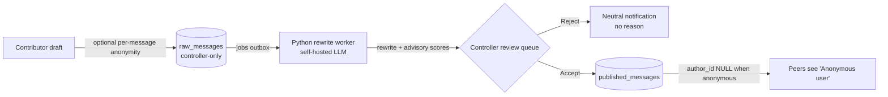

# Talk It Out 🛡️
### Asynchronous Safe Deliberation & Psychological Safety Platform

[](https://github.com/Oscar-man-shrestha/Talk-It-Out/actions/workflows/backend-ci.yml)
[](https://github.com/Oscar-man-shrestha/Talk-It-Out/actions/workflows/flutter-ci.yml)
[](https://github.com/Oscar-man-shrestha/Talk-It-Out/actions/workflows/pipeline-ci.yml)
[](https://flutter.dev)
[](https://riverpod.dev)
[](backend/README.md)
[](LICENSE)

> **Talk It Out** is an asynchronous deliberation platform for teams that need candid feedback without fear of retaliation. Contributors can send any group message **anonymously**; an **AI rewrite** turns heated wording into a constructive proposal, and the group's **controller** reviews every message before anyone else sees it.

---

## 📌 Table of Contents

- [The Core Problem & Solution](#-the-core-problem--solution)
- [Key Architectural Innovations](#-key-architectural-innovations)
- [Complete Feature Showcase](#-complete-feature-showcase)
- [Documentation Suite](#-documentation-suite)
- [Getting Started](#-getting-started)
  - [Prerequisites](#prerequisites)
  - [Installation & Code Generation](#installation--code-generation)
  - [Running in Mock Mode (Default)](#running-in-mock-mode-default)
  - [Running the Full Stack](#running-the-full-stack)
- [Quality Gates & Automated Tests](#-quality-gates--automated-tests)
- [Project Architecture & Directory Structure](#-project-architecture--directory-structure)
- [Non-Negotiable Privacy Hard Rules](#-non-negotiable-privacy-hard-rules)
- [Technology Stack](#-technology-stack)
- [Contact](#-contact)
- [License](#-license)

---

## 💡 The Core Problem & Solution

In conventional collaboration tools (Slack, Teams, Discord, email), candid dissenting opinions are routinely withheld because individual contributors fear career retribution, peer judgment, or political friction. When stressed teammates do speak up, messages are often written in defensive or accusatory language, leading to flame wars and polarization.



| Conventional Tools (Slack / Teams) | Talk It Out Platform |
|---|---|
| **Permanent Identity Attachment:** Submissions carry names; psychological safety is low. | **Per-Message Anonymity:** One checkbox hides the sender from the group. Published anonymous messages store `author_id = NULL`. The controller still sees who sent it, and the app says so next to the checkbox. |
| **Toxic or Accusatory Phrasing:** Heated messages derail retrospectives. | **AI Tone Rewrite:** A self-hosted model rephrases the message constructively. Deterministic checks reject rewrites that drop numbers, negations, or links. |
| **Moderator Burnout:** Facilitators manually referee and rephrase heated comments. | **Assisted Review Queue:** The controller sees the original, the rewrite, a word-level diff, and advisory intent-preservation and agenda-relevance scores, then accepts or rejects. |
| **Dominant Voices Monopolize:** Loudest meeting participants drown out quiet peers. | **Asynchronous Queue:** Every proposal enters the same queue. Relevance is advisory only and never hides a message. |
| **Submission "Black Hole":** Rejection reasons spark resentment or feedback probing. | **Author Ledger ("My Messages"):** Status only (`pending`, `accepted`, `rejected`), with neutral notifications and no rejection reason. |

---

## 🔬 Key Architectural Innovations

### 1. Dual-Table Identity Separation
Talk It Out does not store the sender on a chat row and hide it in the UI. It keeps two tables:
- **`raw_messages`:** the original draft, the real author, and the pipeline results. Only the group's controller can read these, through the review endpoints (`403` for everyone else).
- **`published_messages`:** what the group sees. An anonymous message is stored with **`author_id = NULL`**, enforced by a database constraint:
  ```sql
  CONSTRAINT anonymous_author_consistency CHECK (
    (is_anonymous AND author_id IS NULL)
    OR (NOT is_anonymous AND author_id IS NOT NULL)
  )
  ```
- **Result:** group-facing endpoints cannot leak an anonymous author, because the published row has none. This is moderation-backed anonymity, not cryptographic anonymity: `raw_messages` still records the author, and the controller can see it.

### 2. Rewrite Pipeline (Python worker + self-hosted model)
Submissions are queued in a Postgres `jobs` outbox and never block the UI:
- **Rewrite:** an external Python worker ([`pipeline/`](pipeline/README.md)) claims a job over an authenticated internal HTTP API, asks a self-hosted OpenAI-compatible model (validated: Qwen2.5-3B-Instruct on vLLM) for a constructive rewrite, and posts the result back. It never touches the database and never receives the sender's identity.
- **Safety checks:** deterministic validation (numbers, negations, and URLs must survive; length limits; prompt-scaffold echo detection) plus prompt-injection defenses tested with adversarial probes.
- **Scores:** intent preservation and agenda relevance are documented heuristics, advisory only.
- Without a model, the backend's labeled stub worker keeps the whole flow testable.

### 3. Controller Parity & Moderation Governance
Controllers are room leaders. They have:
- A protected review queue with rewrites, a diff, and advisory scores.
- A composer for official announcements, published directly without review.
- Moderation tools: add members by username, remove members, delete published messages.
- Hand-over: if a controller leaves or deletes their account, the earliest-joined member becomes controller automatically.

---

## 🚀 Complete Feature Showcase

| Feature | Description | Screen / Component |
|---|---|---|
| **🔐 Authentication & Session Lifecycle** | Login and registration. Access and rotating refresh tokens live only in `flutter_secure_storage`; on a `401` the app refreshes once and replays the request. **Sign in with Google** (API.md 40). "Forgot?" resets the password with an emailed 6-digit code (API.md 38); "Keep active session" decides whether a refresh token is kept. | [LoginScreen](lib/features/auth/login_screen.dart), [RegisterScreen](lib/features/auth/register_screen.dart), [ForgotPasswordScreen](lib/features/auth/forgot_password_screen.dart) |
| **🛡️ Account Security** | Change password and "Sign out of all devices": every token carries a version, so ending sessions works instantly on every device. | [ProfileScreen](lib/features/profile/profile_screen.dart) |
| **👥 Deliberation Groups** | Agenda-anchored rooms. The creator becomes `Controller`. | [GroupsScreen](lib/features/groups/groups_screen.dart), [CreateGroupScreen](lib/features/groups/create_group_screen.dart) |
| **⚡ Live Updates** | New messages, reviews, posts, members and alerts appear instantly, like a messaging app: Postgres `NOTIFY` → Server-Sent Events (`/events`, API.md 41) → the app refreshes only what changed. It reconnects with backoff and resyncs after a gap. | [RealtimeClient](lib/core/realtime/realtime_client.dart) |
| **💬 Modern Bubble Group Chat** | Chat bubbles with left/right alignment (decided by user id), timestamps, role badges, and an emoji picker. Chats are text only. | [GroupChatScreen](lib/features/groups/group_chat_screen.dart) |
| **👻 Per-Message Anonymity** | "Anonymous message" checkbox just before Send, with the disclosure that the controller can still see the sender. | [GroupChatScreen (Composer)](lib/features/groups/group_chat_screen.dart) |
| **📢 Controller Announcements** | Controllers post official messages directly, without the review queue. | [GroupChatScreen (Controller Bar)](lib/features/groups/group_chat_screen.dart) |
| **🤖 AI Review Queue** | Original, AI rewrite, word-level diff, and advisory scores, side by side. Order by age, relevance or readiness; a relevance mark labels messages but never hides them; "new rewrite" asks the AI again (API.md 43). | [ReviewQueueScreen](lib/features/review/review_queue_screen.dart), [ReviewDetailScreen](lib/features/review/review_detail_screen.dart) |
| **⚡ Accept or Reject** | Accept publishes the rewrite; reject sends a neutral notification with no reason. The Approved and Rejected tabs keep a read-only history of every decision (API.md 45). | [ReviewQueueScreen](lib/features/review/review_queue_screen.dart) |
| **📋 Contributor Status Ledger** | "My Messages" shows your own submissions' status only. | [MyMessagesScreen](lib/features/groups/my_messages_screen.dart) |
| **❤️ Emoji Reactions** | 👍 ❤️ 🔥 💡 👏 🎯 on published messages, stored on the server. Only counts are shown, never who reacted. | [GroupChatScreen](lib/features/groups/group_chat_screen.dart) |
| **↩️ Quote-Reply** | Attach a quoted snippet of a message above the composer. | [GroupChatScreen](lib/features/groups/group_chat_screen.dart) |
| **🗑️ Controller Message Deletion** | Controllers delete inappropriate published messages (reactions go with them). | [GroupChatScreen](lib/features/groups/group_chat_screen.dart) |
| **🛡️ Members & Hand-Over** | Add by username, remove, or leave. A departing controller hands the group to the earliest-joined member. | [MembersScreen](lib/features/groups/members_screen.dart) |
| **👤 Profile** | Name, headline, bio, links, and skills, saved to the server. Email is shown only on your own profile. "Default Tone Target" sets how the AI words your named messages (anonymous ones always use the default; API.md 44). | [ProfileScreen](lib/features/profile/profile_screen.dart) |
| **💼 Experience & Education** | Add, edit, and delete roles and schools. | [ProfileScreen](lib/features/profile/profile_screen.dart) |
| **📸 Avatar & Cover Upload** | PNG, JPEG, or WebP up to 2 MB, type checked from the file bytes. Presets are uploaded too, so they persist. | [ProfileScreen](lib/features/profile/profile_screen.dart) |
| **🗑️ Delete Account** | Password-confirmed. Controlled groups are handed over; published group messages stay but become anonymous; everything else of yours is removed. | [ProfileScreen](lib/features/profile/profile_screen.dart) |
| **🌐 Public Feed (Q&A)** | Ask a question with a title, a topic and details (validated, API.md 42). Filter by topic or status (including your saved questions), sort by newest, likes or discussion. Likes and comments always show the author (no anonymity). Share copies a link. A post's author can turn it into a group or delete it. Reply mentions the person; anyone can report a comment, and the question's author sees the reports and can remove it (API.md 46–47). | [FeedScreen](lib/features/feed/feed_screen.dart), [PostDetailScreen](lib/features/feed/post_detail_screen.dart) |
| **🔔 Notification Center** | Unread badge (checked on resume and every 30 s), All/Unread filters, mark one or all read. | [NotificationsScreen](lib/features/notifications/notifications_screen.dart) |
| **📱 Responsive Layout** | Mobile, tablet, and desktop widths in the Monochrome Precision style. | [StitchChrome](lib/core/ui/stitch_chrome.dart) |

---

## 📚 Documentation Suite

| Document | Purpose & Target Audience |
|---|---|
| **[LOGS.md](LOGS.md)** | **Living project status:** Status Snapshot, Open Decisions, and every run's results. Start here. |
| **[API.md](API.md)** | **HTTP contract:** every endpoint the app calls (sections 1–9) and the later additions (section 10). |
| **[backend/README.md](backend/README.md)** | **Backend:** setup, migrations, tests, deployment, and production checklist. |
| **[backend/docs/groups-pipeline-contract.md](backend/docs/groups-pipeline-contract.md)** | **Worker contract:** the internal API between the backend and the rewrite worker. |
| **[pipeline/README.md](pipeline/README.md)** | **Rewrite worker:** configuration, scoring, validation, and privacy rules. |
| **[docs/SETUP_GOOGLE_AND_EMAIL.md](docs/SETUP_GOOGLE_AND_EMAIL.md)** | **Google sign-in and Gmail:** getting the Google Client ID and a Gmail app password, step by step. |
| **[pipeline/KAGGLE_ENDPOINT_RUNBOOK.md](pipeline/KAGGLE_ENDPOINT_RUNBOOK.md)** | **Model hosting:** serving the model on a Kaggle GPU behind an API key and tunnel. |
| **[PRD.md](PRD.md)** | **Product requirements:** vision, personas, role permissions, and feature requirements. |
| **[DATA.md](DATA.md)** | **Frontend data:** models, serialization contracts, and mock seed data. |
| **[ARCHITECTURE.md](ARCHITECTURE.md), [PLAN.md](PLAN.md), [HANDOFF.md](HANDOFF.md), [BACKEND_DATABASE_HANDOFF_REPORT.md](BACKEND_DATABASE_HANDOFF_REPORT.md)** | **Original design proposals** written before the backend existed. They describe options (WebSockets, Redis/BullMQ, S3) that the shipped system replaced with polling, a Postgres outbox, and Postgres image storage. Use API.md and LOGS.md for what is actually built. |

---

## 🛠️ Getting Started

### Prerequisites
- **Flutter SDK:** 3.47 (stable channel) with Dart 3.13. Check with `flutter doctor`.
- **For the full stack:** Node.js 20+, PostgreSQL 16 (Docker or local), and Python 3.10+ for the rewrite worker.
- **A browser or simulator:** Chrome, macOS desktop, iOS Simulator, or Android Emulator.

### Installation & Code Generation
```bash
# 1. Clone the repository
git clone https://github.com/Oscar-man-shrestha/Talk-It-Out.git
cd Talk-It-Out

# 2. Install dependencies
flutter pub get

# 3. (Only after changing models) regenerate Freezed models & JSON serializers
dart run build_runner build --delete-conflicting-outputs
```

### Running in Mock Mode (Default)
The app runs entirely in memory, without a backend:

```bash
flutter run -d web-server --web-hostname=127.0.0.1 --web-port=52000 --dart-define=USE_MOCK=true
```

Then open `http://127.0.0.1:52000/#/login` in your browser.

#### Demo Credentials (Mock Mode)
- **Email:** `priya@example.com`
- **Password:** `secret123`
- *Role details:* Priya is a **Contributor** in *"Making NLP notes"* (try anonymous submission) and the **Controller** of *"Dashboard improvements"* (try the review queue, accepting rewrites, and announcements).

### Running Everything with Docker (one command)
```bash
cp .env.stack.example .env    # set POSTGRES_PASSWORD and JWT_SECRET (openssl rand -hex 32)
docker compose up -d --build
```
Open `http://localhost:8080` (app) — the API is on `http://localhost:3000`. Migrations run automatically once in the `migrate` service before the API starts. Gmail and Google sign-in are switched on from the same `.env` ([setup guide](docs/SETUP_GOOGLE_AND_EMAIL.md)). The `stack-ci` workflow boots this exact stack on every relevant push.

### Running the Full Stack (without Docker)
1. **Backend** (see [backend/README.md](backend/README.md)):
   ```bash
   cd backend
   cp .env.example .env          # set a real JWT_SECRET and database URLs
   npm install && npm run migrate && npm run dev
   ```
   Set `MAIL_TRANSPORT=log` to see password-reset codes in this console (use `smtp` with `SMTP_URL` for real email). With `PIPELINE_MODE=stub` and `RUN_STUB_WORKER=true`, rewrites are labeled placeholders, so everything works without a model. `bash scripts/demo-flow.sh` runs the whole moderation flow against the API.
2. **App against the backend:**
   ```bash
   flutter run -d web-server --web-hostname=127.0.0.1 --web-port=52001 \
     --dart-define=USE_MOCK=false \
     --dart-define=API_BASE_URL=http://localhost:3000
   ```
3. **Real AI rewrites:** run the model locally with Ollama (`brew install ollama && brew services start ollama && ollama pull qwen2.5:3b`; [pipeline/README.md](pipeline/README.md#local-model-on-a-mac-ollama--the-default-dev-setup)) or on a Kaggle GPU ([runbook](pipeline/KAGGLE_ENDPOINT_RUNBOOK.md)); set `PIPELINE_MODE=external` in `backend/.env` and run `cd pipeline && python3 -m talkitout_pipeline`. Check everything with `cd backend && npm run check:live`.

---

## 🧪 Quality Gates & Automated Tests

GitHub Actions runs four workflows: `backend-ci` (lint, build, tests, blocking dependency audit, and an end-to-end run against a live server), `flutter-ci`, `pipeline-ci`, and `stack-ci` (the whole Docker stack). Locally:

```bash
# Flutter app
dart format --output=none --set-exit-if-changed lib test
flutter analyze
flutter test

# Backend (needs the test database from backend/.env)
cd backend && npm run lint && npm test

# Rewrite worker (stdlib only)
cd pipeline && python3 -m unittest discover -s tests -t .
```

### Key Automated Privacy Assertions
- `test/no_raw_message_import_test.dart`: group-facing code **never imports `RawMessage`**.
- `test/privacy_ui_test.dart`: null senders render as `"Anonymous user"`, the disclosure sits next to the checkbox, review routes are guarded, and rejection notifications carry no reason.
- `backend/test/privacy.logs.test.ts`: server logs never contain message text, tokens, or passwords.
- `backend/test/contract.test.ts`: every response matches the exact fields the app expects, so no extra identity fields can appear.

---

## 📂 Project Architecture & Directory Structure

Feature-first Flutter client, an Express API, and a separate Python worker:

```
lib/                       # Flutter app
├── app/                   # App root, config (USE_MOCK, API_BASE_URL), router + guards, shell, theme
├── core/
│   ├── api/               # Dio client, auth + refresh interceptor, endpoints catalog
│   ├── errors/            # RepositoryException and user-facing error mapping
│   ├── mock/              # In-memory mock data and controls
│   ├── models/            # Shared Freezed models and tolerant enums
│   ├── storage/           # Secure token storage
│   ├── strings/           # All user-facing copy (AppStrings)
│   ├── ui/, widgets/      # Shared chrome, async states, images
│   └── utils/             # Image picking and preset download
└── features/
    ├── auth/              # Login, registration, session, account deletion
    ├── groups/            # Groups, chat, composer, members, "My messages"
    ├── review/            # Controller-only review queue (RawMessage lives only here)
    ├── feed/              # Public feed, comments, post-to-group
    ├── notifications/     # Notification center and unread polling
    └── profile/           # Profile, experience, education, images
backend/                   # Express 5 + PostgreSQL API, migrations, tests, Dockerfile
pipeline/                  # Python rewrite worker (stdlib only), tests, model scripts
```

---

## 🔒 Non-Negotiable Privacy Hard Rules

1. **Group-Facing Isolation:** Group chat screens consume **only** `PublishedMessage`. If a message is anonymous, `sender` is `null` and renders as `"Anonymous user"`.
2. **Review Isolation:** `RawMessage` exists only inside `features/review/`. It is never imported into contributor or group code.
3. **No "Show Original" UI:** Contributors can never view another contributor's original text. No toggle, button, or menu exists.
4. **Permanent Anonymity Disclosure:** *"Anonymous messages are hidden from the group but visible to the controller."* is always shown next to the checkbox, before Send.
5. **Probe-Proof Rejections:** Rejection notifications never include reasons or feedback.
6. **Zero Raw Logging:** Message text and anonymous authors are never printed, cached, or sent to analytics, in the app, the backend, or the worker.

---

## 💻 Technology Stack

- **Client:** [Flutter](https://flutter.dev) 3.47 / Dart 3.13 (web and cross-platform, sound null safety)
- **State Management:** [Riverpod](https://riverpod.dev) 3 (`AsyncNotifier`)
- **Navigation:** [GoRouter](https://pub.dev/packages/go_router) 18 (guarded declarative routing)
- **Networking & Storage:** [Dio](https://pub.dev/packages/dio) 5, [flutter_secure_storage](https://pub.dev/packages/flutter_secure_storage) 11
- **Code Generation:** [Freezed](https://pub.dev/packages/freezed) 4 and [json_serializable](https://pub.dev/packages/json_serializable)
- **Backend:** Express 5, TypeScript, PostgreSQL 16 (plain SQL migrations), zod, argon2, JWT access plus rotating refresh tokens, vitest + supertest
- **Rewrite worker:** Python 3.10+ (stdlib only) calling a self-hosted OpenAI-compatible model (vLLM, Qwen2.5-3B-Instruct)
- **Visual Design:** **Monochrome Precision** (black and white with subtle borders, 48dp minimum touch targets)

---

## ✉️ Contact

Project email: **talkitoutapp.mail@gmail.com**. Password-reset codes are sent from this address too.

---

## 📄 License

This project is licensed under the MIT License. See the [LICENSE](LICENSE) file for details.
