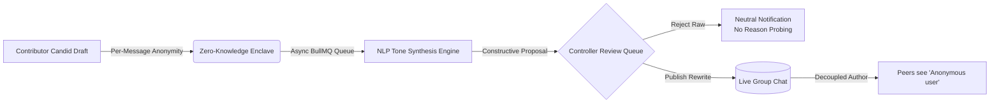

# Talk It Out 🛡️
### Asynchronous Safe Deliberation & Psychological Safety Platform

[](https://flutter.dev)
[](https://dart.dev)
[](https://riverpod.dev)
[](https://pub.dev/packages/go_router)
[](file:///Users/oscar/Desktop/talk_it_out/ARCHITECTURE.md#2-mathematical--cryptographic-anonymity-enclave)
[](file:///Users/oscar/Desktop/talk_it_out/LICENSE)
[]()

> **Talk It Out** is an asynchronous deliberation platform engineered to eliminate fear of retaliation, hierarchical intimidation, and toxic debate in modern organizations. Through **per-message mathematical anonymity** and **AI non-adversarial tone synthesis**, teams surface ground-truth feedback and build high-trust consensus.

---

## 📌 Table of Contents

- [The Core Problem & Solution](#-the-core-problem--solution)
- [Key Architectural Innovations](#-key-architectural-innovations)
- [Complete Feature Showcase](#-complete-feature-showcase)
- [Documentation Suite](#-documentation-suite)
- [Getting Started](#-getting-started)
  - [Prerequisites](#prerequisites)
  - [Installation & Code Generation](#installation--code-generation)
  - [Running in Mock Mode (Default)](#running-in-mock-mode-default)
  - [Connecting to a Live Backend](#connecting-to-a-live-backend)
- [Quality Gates & Automated Tests](#-quality-gates--automated-tests)
- [Project Architecture & Directory Structure](#-project-architecture--directory-structure)
- [Non-Negotiable Privacy Hard Rules](#-non-negotiable-privacy-hard-rules)
- [Technology Stack](#-technology-stack)
- [License](#-license)

---

## 💡 The Core Problem & Solution

In conventional collaboration tools (Slack, Teams, Discord, email), candid dissenting opinions are routinely withheld because individual contributors fear career retribution, peer judgment, or political friction. When stressed teammates do speak up, messages are often written in defensive or accusatory language, leading to flame wars and organizational polarization.



| Conventional Tools (Slack / Teams) | Talk It Out Platform |
|---|---|
| **Permanent Identity Attachment:** Submissions carry names; psychological safety is low. | **Per-Message Anonymity:** Contributors can shield identity with one tap. Public messages store `author_id = NULL`. |
| **Toxic or Accusatory Phrasing:** Heated messages derail retrospectives. | **AI Tone Synthesis:** NLP models reframe statements into constructive, solution-oriented proposals preserving 100% of technical substance. |
| **Moderator Burnout:** Facilitators manually referee and rephrase heated comments. | **Assisted Review Queue:** AI computes objective toxicity scores, agenda relevance, and visual diff proposals for instant Controller approval. |
| **Dominant Voices Monopolize:** Loudest meeting participants drown out quiet peers. | **Asynchronous Queue:** All proposals enter the review queue with equal priority and cryptographic protection. |
| **Submission "Black Hole":** Rejection reasons spark resentment or feedback probing. | **Author Ledger ("My Messages"):** Real-time status pills (`pending`, `accepted`, `rejected`) with neutral notification delivery. |

---

## 🔬 Key Architectural Innovations

### 1. Dual-Table Zero-Knowledge Identity Decoupling
Unlike traditional platforms that store `user_id` on every chat message and simply toggle a frontend UI visibility flag, Talk It Out physically isolates identities at the relational database level:
- **`raw_messages` table:** Stores the contributor's true author ID, raw draft text, and AI evaluation metrics. Accessible **strictly** by room Controllers.
- **`published_messages` table:** Public chat table queried by peers. When marked anonymous, `author_id` is set to **`NULL`** enforced by database check constraints:
  ```sql
  CONSTRAINT chk_anonymity_author_null CHECK (
      (is_anonymous = TRUE AND author_id IS NULL) OR
      (is_anonymous = FALSE)
  )
  ```
- **Result:** No SQL leak, network sniffing, or API over-fetching vulnerability can ever compromise an anonymous contributor.

### 2. Two-Stage NLP Moderation & Constructive Tone Pipeline
Raw submissions undergo an asynchronous evaluation before reaching the Controller:
- **Stage 1 (Advisory Scoring):** Perspective/transformer toxicity classification (0.0 to 1.0) and vector cosine similarity against the group's agenda (relevance score 0.0 to 1.0).
- **Stage 2 (Non-Adversarial Tone Synthesis):** An LLM rephrases accusatory or passive-aggressive language into objective, actionable proposals while strictly retaining 100% of underlying technical arguments, bugs, and risks.

### 3. Controller Parity & Moderation Governance
Controllers are empowered room leaders. They possess:
- A protected Review Queue with AI proposals and objective metrics.
- A unified WhatsApp-style composer to post official announcements directly to the room.
- Authority to moderate participants (invite by `@username`, kick non-cooperative members, delete inappropriate published messages).

---

## 🚀 Complete Feature Showcase

| Feature | Description | Screen / Component |
|---|---|---|
| **🔐 Authentication & Session Lifecycle** | Secure login, registration, and hardware-backed JWT storage (`flutter_secure_storage`). | [LoginScreen](file:///Users/oscar/Desktop/talk_it_out/lib/features/auth/login_screen.dart), [RegisterScreen](file:///Users/oscar/Desktop/talk_it_out/lib/features/auth/register_screen.dart) |
| **👥 Deliberation Groups** | Agenda-anchored deliberation rooms. Group creators automatically assigned `Controller`. | [GroupsScreen](file:///Users/oscar/Desktop/talk_it_out/lib/features/groups/groups_screen.dart), [CreateGroupScreen](file:///Users/oscar/Desktop/talk_it_out/lib/features/groups/create_group_screen.dart) |
| **💬 Modern Bubble Group Chat** | WhatsApp/Instagram-style chat bubbles with distinct left/right alignment, timestamps, and role badges. | [GroupChatScreen](file:///Users/oscar/Desktop/talk_it_out/lib/features/groups/group_chat_screen.dart) |
| **👻 Per-Message Anonymity Ingress** | Dedicated anonymity checkbox sitting immediately above Send with clear cryptographic disclosure. | [GroupChatScreen (Composer)](file:///Users/oscar/Desktop/talk_it_out/lib/features/groups/group_chat_screen.dart) |
| **📢 Controller Direct Messaging Parity** | Controllers possess an identical clean composer to post official guidance without review delays. | [GroupChatScreen (Controller Bar)](file:///Users/oscar/Desktop/talk_it_out/lib/features/groups/group_chat_screen.dart) |
| **🤖 AI Moderation & Review Queue** | Side-by-side inspection of raw drafts, AI neutral rewrites, toxicity meters, and agenda relevance. | [ReviewQueueScreen](file:///Users/oscar/Desktop/talk_it_out/lib/features/review/review_queue_screen.dart) |
| **⚡ One-Tap Publish & Safe Reject** | Approve AI rewrites to live chat or reject drafts with neutral notifications and zero probe feedback. | [ReviewQueueScreen](file:///Users/oscar/Desktop/talk_it_out/lib/features/review/review_queue_screen.dart) |
| **📋 Contributor Status Ledger** | "My Messages" view showing personal submission status (`pending`, `accepted`, `rejected`). | [MyMessagesScreen](file:///Users/oscar/Desktop/talk_it_out/lib/features/groups/my_messages_screen.dart) |
| **❤️ Floating Emoji Reactions** | Long-press or tap reaction bar (👍, ❤️, 🔥, 💡, 👏, 🎯) with live count aggregations. | [GroupChatScreen](file:///Users/oscar/Desktop/talk_it_out/lib/features/groups/group_chat_screen.dart) |
| **↩️ Threaded Quote-Reply System** | Swipe or click to attach a quoted message snippet above the composer. | [GroupChatScreen](file:///Users/oscar/Desktop/talk_it_out/lib/features/groups/group_chat_screen.dart) |
| **🗑️ Controller Message Deletion** | Moderators can redact or delete inappropriate published messages. | [GroupChatScreen](file:///Users/oscar/Desktop/talk_it_out/lib/features/groups/group_chat_screen.dart) |
| **🛡️ Member Moderation** | Invite colleagues by `@username`, kick disruptive users, or leave groups voluntarily. | [MembersScreen](file:///Users/oscar/Desktop/talk_it_out/lib/features/groups/members_screen.dart) |
| **👤 Rich Professional Profile** | Public identity card, dynamic skills chip editor, social links (Website, GitHub, Twitter, LinkedIn). | [ProfileScreen](file:///Users/oscar/Desktop/talk_it_out/lib/features/profile/profile_screen.dart) |
| **💼 Career History & Education CRUD** | Add, edit, and delete work experiences and academic credentials. | [ProfileScreen](file:///Users/oscar/Desktop/talk_it_out/lib/features/profile/profile_screen.dart) |
| **📸 Native Media File Upload** | OS-level image file picker (`pickImageFile()`) for custom avatars and cover banners + curated presets. | [ProfileScreen](file:///Users/oscar/Desktop/talk_it_out/lib/features/profile/profile_screen.dart) |
| **🌐 Public Community Feed** | Open discussions with likes and threaded comments. Non-anonymous. Escalates to deliberation groups. | [FeedScreen](file:///Users/oscar/Desktop/talk_it_out/lib/features/feed/feed_screen.dart) |
| **🔔 Notification Center** | Real-time badge counter, read/unread filters, and one-tap "Mark all as read". | [NotificationsScreen](file:///Users/oscar/Desktop/talk_it_out/lib/features/notifications/notifications_screen.dart) |
| **📱 Cross-Device Responsiveness** | Adaptive layout engine tuned for mobile (<600px), tablet (600–900px), and desktop in Monochrome style. | [StitchChrome](file:///Users/oscar/Desktop/talk_it_out/lib/core/ui/stitch_chrome.dart) |

---

## 📚 Documentation Suite

The repository contains an exhaustive, production-grade documentation package for all disciplines:

| Document | Purpose & Target Audience |
|---|---|
| **[BACKEND_DATABASE_HANDOFF_REPORT.md](file:///Users/oscar/Desktop/talk_it_out/BACKEND_DATABASE_HANDOFF_REPORT.md)** | **Master Handoff Report:** Single-source guide for backend and DB engineers detailing all 18 features, SQL schema, NLP prompt pipeline, WebSockets, and rollout steps. |
| **[PRD.md](file:///Users/oscar/Desktop/talk_it_out/PRD.md)** | **Product Requirements Document:** Vision, user personas (Maya, Julian, Observers), role permissions matrix, feature requirements, and compliance. |
| **[ARCHITECTURE.md](file:///Users/oscar/Desktop/talk_it_out/ARCHITECTURE.md)** | **System & Database Design:** Component topology, Zero-Knowledge isolation model, complete PostgreSQL 16 DDL, Redis/BullMQ worker queues, and security threats. |
| **[PLAN.md](file:///Users/oscar/Desktop/talk_it_out/PLAN.md)** | **Engineering Execution Plan:** 4-sprint, 6-phase engineering roadmap with deliverables, acceptance criteria, and team ownership matrix. |
| **[HANDOFF.md](file:///Users/oscar/Desktop/talk_it_out/HANDOFF.md)** | **Integration & API Contract:** Full REST API tables, exact request/response JSON schemas, error codes, and live-mode testing guide. |
| **[API.md](file:///Users/oscar/Desktop/talk_it_out/API.md)** | **REST API Reference:** Quick reference for all HTTP endpoints, parameter schemas, and mock seed data. |
| **[DATA.md](file:///Users/oscar/Desktop/talk_it_out/DATA.md)** | **Data Architecture & DTOs:** Frontend models, serialization contracts, and mock persona dictionaries. |
| **[LOGS.md](file:///Users/oscar/Desktop/talk_it_out/LOGS.md)** | **Living Project Changelog:** Chronological run entries, quality gate results, and architectural decisions. |

---

## 🛠️ Getting Started

### Prerequisites
- **Flutter SDK:** Version `3.22.x` or higher (stable channel). Check with `flutter doctor`.
- **Dart SDK:** Version `3.4.x` or higher.
- **Web Browser or Simulator:** Google Chrome, macOS desktop, iOS Simulator, or Android Emulator.

### Installation & Code Generation
```bash
# 1. Clone the repository
git clone https://github.com/Oscar-man-shrestha/Talk-It-Out.git
cd Talk-It-Out

# 2. Install dependencies
flutter pub get

# 3. Generate Freezed models & JSON serializers
dart run build_runner build --delete-conflicting-outputs
```

### Running in Mock Mode (Default)
The app runs completely self-contained in memory without needing a backend server:

```bash
flutter run -d web-server --web-hostname=127.0.0.1 --web-port=52000 --dart-define=USE_MOCK=true
```

Then open `http://127.0.0.1:52000/#/login` in your browser.

#### Demo Credentials (Mock Mode)
- **Email:** `priya@example.com`
- **Password:** `secret123`
- *Role Details:* Priya Sharma is a **Contributor** in *"Making NLP notes"* (can test anonymous message submission) and the **Controller** of *"Dashboard improvements"* (can test review queue, approving rewrites, and direct announcements).

### Connecting to a Live Backend
When your backend team deploys the API services:

```bash
flutter run -d web-server --web-port=52000 \
  --dart-define=USE_MOCK=false \
  --dart-define=API_BASE_URL=http://localhost:3000/api/v1
```

---

## 🧪 Quality Gates & Automated Tests

This project enforces strict CI quality gates. Every release must satisfy:

```bash
# 1. Code formatting check
dart format --output=none --set-exit-if-changed .

# 2. Static code analysis (must have 0 issues)
flutter analyze

# 3. Automated privacy & unit test suite
flutter test
```

### Key Automated Privacy Assertions
- `test/no_raw_message_import_test.dart`: Statically asserts that group-facing screens **never import `RawMessage`**, preventing code leaks.
- `test/privacy_ui_test.dart`: Validates that null senders render as `"Anonymous user"`, disclosures are visible next to checkboxes, review queues are route-guarded, and rejection notifications contain no reason text.

---

## 📂 Project Architecture & Directory Structure

The project follows a **Feature-First Clean Architecture** with immutable Freezed state models:

```
lib/
├── app/
│   ├── app.dart                   # Root MaterialApp & theme configuration
│   ├── repository_providers.dart  # Dynamic Mock vs API repository switch (USE_MOCK)
│   ├── router.dart                # GoRouter declarations & Controller route guards
│   ├── shell.dart                 # Persistent bottom navigation shell
│   └── theme.dart                 # Monochrome Precision light theme tokens
├── core/
│   ├── api/                       # Dio client, AuthInterceptor, endpoints catalog
│   ├── errors/                    # AppFailure hierarchy & user-friendly error mappers
│   ├── strings/                   # Centralized string constants (AppStrings)
│   ├── ui/                        # Reusable StitchChrome, responsive layout utilities
│   └── utils/                     # Responsive breakpoints, date formatters
└── features/
    ├── auth/                      # Login, registration, token persistence
    ├── groups/                    # Groups directory, WhatsApp-style chat, composer, ledger
    ├── review/                    # Protected Controller review queue (RawMessage enclave)
    ├── feed/                      # Public community feed, comments, group conversion
    ├── notifications/             # Notification center & unread badge state
    └── profile/                   # Professional identity, skills, experiences, educations
```

---

## 🔒 Non-Negotiable Privacy Hard Rules

1. **Group-Facing Isolation:** Group chat screens consume **only** `PublishedMessage`. If `is_anonymous = true`, `sender` is strictly `null` (rendering as `"Anonymous user"`).
2. **Review Enclave Isolation:** `RawMessage` exists strictly inside `features/review/`. It is never imported into contributor or group code.
3. **No "Show Original" UI:** Contributors can never view another contributor's raw text. No toggle, button, or menu exists.
4. **Permanent Anonymity Disclosure:** The disclosure *"Anonymous messages are hidden from the group but visible to the controller."* is permanently visible before the Send action.
5. **Probe-Proof Rejections:** Rejection notifications never include reasons or feedback to prevent adversarial trial-and-error probing.
6. **Zero Raw Logging:** Raw message contents and anonymous author IDs are never printed, cached, or logged to analytics.

---

## 💻 Technology Stack

- **Client Framework:** [Flutter](https://flutter.dev) 3.22+ (Web & Cross-Platform)
- **Language:** [Dart](https://dart.dev) 3.4+ (Sound Null Safety)
- **State Management:** [Riverpod](https://riverpod.dev) 2.5 (`AsyncNotifier`, auto-disposing providers)
- **Navigation:** [GoRouter](https://pub.dev/packages/go_router) 14.x (Guarded declarative routing)
- **Secure Storage:** [flutter_secure_storage](https://pub.dev/packages/flutter_secure_storage) (Hardware Keychain / Keystore)
- **Networking:** [Dio](https://pub.dev/packages/dio) 5.x (Interceptors, token injection)
- **Code Generation:** [Freezed](https://pub.dev/packages/freezed) & [json_serializable](https://pub.dev/packages/json_serializable)
- **Visual Design:** **Monochrome Precision** (Clean black & white aesthetic with subtle borders and 48dp minimum touch targets)

---

## 📄 License

This project is licensed under the MIT License — see the [LICENSE](file:///Users/oscar/Desktop/talk_it_out/LICENSE) file for details.
